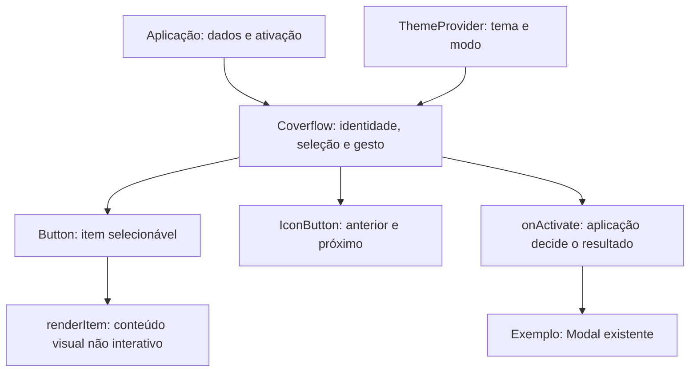

# Playbook — por dentro do Coverflow

Este é um estudo da implementação existente no repositório, não uma promessa de variantes futuras. Os links de fonte/testes exigem o checkout; a ficha de API também acompanha o pacote instalado. Leia junto da [API gerada](../ai/components/Coverflow.json), dos [exemplos funcionais](CAPABILITY_PILOTS.md) e do [processo de autoria](ADVANCED_ORGANISMS.md).

## 1. Começar pela tarefa

A tarefa genérica é explorar uma sequência visual finita, selecionar um item e ativá-lo explicitamente. Capas de música são uma aplicação possível; imagens, artistas, compra, propriedade e reprodução não fazem parte do organismo. A demonstração usa arte abstrata própria.

O gap era coordenação reutilizável de posição, identidade, gesto e seleção. Button e IconButton já existiam; precisavam ser compostos, não recriados. O tema continua no ThemeProvider do consumidor.

## 2. Definir a API mínima

Fonte: [Coverflow.tsx](../src/components/Coverflow/Coverflow.tsx), interfaces CoverflowItem/CoverflowProps.

| Entrada | Responsabilidade |
| --- | --- |
| items / id / label | Identidade estável e nome acessível; IDs únicos são contrato do chamador |
| renderItem(item, state) | Conteúdo visual e informação selected/index; sem controles interativos aninhados |
| selectedId / onSelectionChange | Seleção controlada por ID |
| defaultSelectedId | Seleção inicial quando não controlado |
| onActivate | Ação explícita sobre o item já selecionado |
| disabled / emptyContent / label | Estados e comunicação contextual |

A interface genérica aceita dados extras do produto sem conhecê-los. Confira a ficha gerada para tipos completos; não mantenha outra cópia de assinatura em um tutorial.

## 3. Uma fonte de seleção

A implementação resolve o ID solicitado e deriva o índice. Sem ID válido, apresenta o primeiro item, sem emitir callback implícito de normalização. Navegar limita o índice às extremidades; a lista não é circular. Reordenar com IDs estáveis preserva identidade.

| Evento | Resultado |
| --- | --- |
| Clique em vizinho | Seleciona/centraliza; não ativa |
| Clique no selecionado / Enter/Espaço | Chama onActivate, quando fornecido |
| Anterior/próximo ou setas | Navega dentro dos limites |
| Home/End no item | Vai ao primeiro/último e transfere foco |
| Mudança externa de seleção | Atualiza posição sem roubar foco |
| Cancelar gesto / intenção vertical | Restaura deslocamento, sem ativação |

Não transforme a posição em outro estado de negócio. stride e offset representam geometria/gesto; a seleção permanece ID. A medição acompanha o container com ResizeObserver, inclusive depois de mudanças de largura ou lista.

## 4. Gesto, foco e semântica

O conteúdo clicável é o Button compartilhado, com aria-pressed e um item por vez no fluxo de Tab. Navegação por teclado transfere foco com preventScroll; alteração de prop não faz isso. O viewport preserva pan-y para a rolagem móvel.

O gesto primeiro identifica intenção horizontal versus vertical, usa captura de ponteiro, calcula deslocamento e resolve a seleção ao terminar. Arraste cancelado não pode virar clique. A implementação também trata a perda real de captura; a transferência de captura implícita do botão filho não significa cancelar o gesto.

Dois defeitos encontrados são exemplos úteis de aceites negativos:

- Um arraste vertical de mouse dentro do Button ativava o item: testar só arraste horizontal não detectava isso.
- Depois de cancelar um arraste, a supressão de clique engolia Enter: cliques de ponteiro e ativação por teclado precisam ser distinguidos.

Ambos tiveram reprodução e testes nos dois motores. Leia [coverflow.spec.ts](../tests/coverflow.spec.ts), especialmente os casos de cancelamento/teclado. Não copie o bloqueio de eventos isoladamente para outro organismo; ele depende desse contrato de gesto.

## 5. Aparência configurável, estado intrínseco separado

Fonte: [Coverflow.module.css](../src/components/Coverflow/Coverflow.module.css).

| Configuração pública opcional | Papel |
| --- | --- |
| --coverflow-item-width | Largura de referência, limitada pelo container |
| --coverflow-item-padding | Espaçamento interno da superfície |
| --coverflow-gap | Separação entre itens |
| --coverflow-angle | Perspectiva lateral em unidade de ângulo |
| --coverflow-perspective | Profundidade em unidade de comprimento |

Cores, fontes, borda e raios vêm da fundação/controles compartilhados. Distância e lado do item são calculados internamente; não são cinco novos presets ou uma paleta de mídia. A posição desloca o track e a perspectiva orienta a seleção, respeitando a configuração de movimento e preferência reduzida. Tema pode mudar forma/fonte; modo muda cores, preservando geometria.

O editor visual valida o tipo de valor: um ângulo não é um comprimento. O teste de personalização do piloto, na suíte interna, exercita importar, editar, exportar e restaurar hooks, inclusive valores recusados.

## 6. Entregar a capacidade inteira

Além dos arquivos do componente, a entrega adicionou export público, família na atomicidade Organismos, associação à coleção media, stories, API/exemplos gerados, orientação de uso, inventário de movimento/hooks, metadados para agentes e política de estados no harness. A história Capas abre um Modal por onActivate para demonstrar uma ação real.

O custo foi medido por pacote instalado, não pelo tamanho do arquivo TSX. Consumidor simples não deve reter Coverflow, D3 ou Prism por causa de um export aditivo. Não adicionar motor de animação, provedor de mídia ou SDK só para demonstrar a sequência.

## 7. Saber o que ainda não está comprovado

A rodada local de30/10/2026 verificou interação, tipos, SSR, build, temas e integração. A comparação exata ainda registrou diferença de pintura nos botões externos do exemplo Controlado, em foco/800px; geometria e estilos medidos coincidiam. Isso permanece investigação técnica, não aprovação pixel perfect nem defeito de foco demonstrado no cartão.

Não há autoplay, repetição circular ou serviço. Aprovação visual humana e ensaios assistivos são estados separados. O playbook mostra como construir e verificar a capacidade; sua existência não certifica o catálogo todo. [Maturidade e evidência](QUALITY.md).
